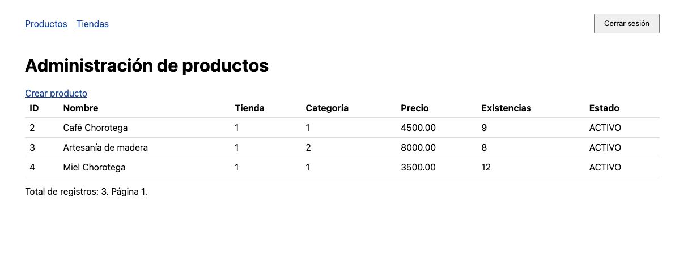
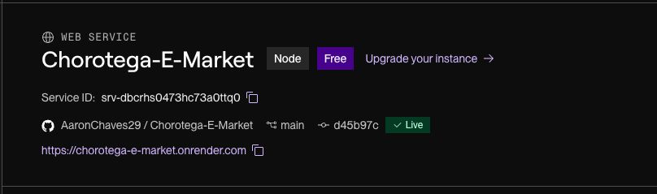
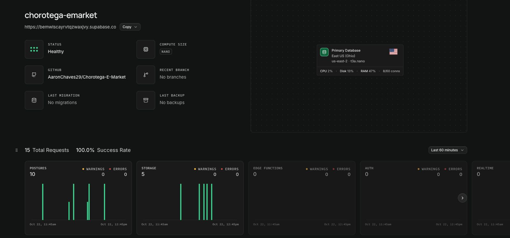

# Laboratorio 6: entrega y evidencia consolidada

Fecha de consolidación: 22 de octubre de 2026. Fuente académica: `EIF509 Laboratorio 6 - Guía Completa.pdf`, páginas físicas 2 (entregables) y 3 (rúbrica y condiciones). El PDF se consultó localmente; no está incorporado al repositorio. La entrega cierra a las 18:00, por repositorio Git y aula virtual.

Este documento distingue implementación, ejecución automatizada, observación pública de solo lectura y comprobaciones manuales reportadas. No asigna una calificación ni declara completos criterios con evidencia pendiente. No contiene credenciales ni autoriza nuevas escrituras en producción.

## Versión y accesos

- Producción se despliega desde `main`; `develop` se utiliza para integración.
- `main` auditado: `d45b97cf0caae338a86a8dc6c393573759308d47`.
- Base de esta rama documental: `develop`, `8ef78d755955fc884add96752b044ad337c7cc6e`.
- [Frontend Next.js en Vercel](https://chorotega-e-market-frontend.vercel.app).
- [Backend NestJS en Render](https://chorotega-e-market.onrender.com).
- [Swagger UI](https://chorotega-e-market.onrender.com/docs) y [OpenAPI JSON](https://chorotega-e-market.onrender.com/docs-json).
- [Acceso MVC administrativo](https://chorotega-e-market.onrender.com/admin/login).

Los SHA anteriores identifican el código revisado y su CI. Las respuestas públicas no identifican el SHA del proceso activo. La [captura de Render incorporada](evidencias/render-deploy.jpeg) muestra `main`, `Live` y `d45b97c`, consistente con el SHA auditado y su CI. Documenta ese estado en el momento de la captura; no se conoce su fecha exacta ni sustituye un registro de migraciones. Supabase aloja PostgreSQL y MongoDB Atlas aloja la bitácora, según la configuración de despliegue reportada; no se publican sus direcciones de conexión.

## Matriz de rúbrica y evidencia

Los puntajes son los pesos oficiales y suman 10; no representan puntos obtenidos.

| Criterio               | Pts | Funcionalidad y evidencia técnica                                                                                                                                                                                                                                                                                                  | Pruebas automatizadas                                                                                                                                                                                | Evidencia manual o pública disponible                                                                                                                                                                                                                                       | Pendiente y acción mínima                                                                                                                                                                                                                         |
| ---------------------- | --- | ---------------------------------------------------------------------------------------------------------------------------------------------------------------------------------------------------------------------------------------------------------------------------------------------------------------------------------- | ---------------------------------------------------------------------------------------------------------------------------------------------------------------------------------------------------- | --------------------------------------------------------------------------------------------------------------------------------------------------------------------------------------------------------------------------------------------------------------------------- | ------------------------------------------------------------------------------------------------------------------------------------------------------------------------------------------------------------------------------------------------- |
| MVC con Thymeleaf      | 2,5 | NestJS + Handlebars: productos y tiendas, listado SQL paginado, formularios con DTOs, errores por campo, PRG 303, ADMIN y CSRF. [Contrato MVC](admin-mvc.md) y [controlador](../../../apps/backend/src/admin/admin-catalog.controller.ts).                                                                                         | [HTTP MVC](../../../apps/backend/test/integration/http/admin-mvc.integration-spec.ts), [Chrome](../../../apps/backend/test/browser/admin-mvc.browser.test.cjs) y unitarias incluidas en CI aprobado. | El equipo reportó pruebas manuales satisfactorias. La [captura incorporada](evidencias/mvc-productos.jpeg) muestra el listado de productos, sin demostrar cambio de página, formulario ni identidad ADMIN. La auditoría comprobó GET del acceso.                            | Adjuntar evidencia individual de ambos casos y confirmar académicamente Handlebars/Thymeleaf. El reporte general no demuestra cada interacción.                                                                                                   |
| SPA en React           | 3,0 | Next.js: login JWT, cookie HttpOnly, listado paginado con carga/datos/error/vacío y creación de pedidos. [Cliente centralizado con manejo de 401](../../../apps/frontend/lib/api-client.ts), [listado](../../../apps/frontend/components/orders-list.tsx) y [formulario](../../../apps/frontend/components/create-order-form.tsx). | CI frontend: lint y build aprobados. HTTP del backend comprueba compra y permisos; no es una prueba de navegador de la SPA.                                                                          | Frontend reportado operativo y `/login` público con 200.                                                                                                                                                                                                                    | Adjuntar recorrido desde Vercel: login, listado/paginación, estados de interfaz, creación y pedido visible, sesión inválida. Documentar/confirmar ubicación `apps/frontend` frente a `/spa`.                                                      |
| Despliegue en la nube  | 2,5 | Vercel + Render + Supabase + Atlas; HTTPS web, TLS de bases y migraciones TypeORM compiladas antes de HTTP. [Configuración y operación](despliegue-render.md), [arranque](../../../apps/backend/src/deployment/start-render.ts) y [ejecutor](../../../apps/backend/src/database/production-migrations.ts).                         | CI backend: build, artefacto, cobertura, integración y Chrome aprobados. Las migraciones de pruebas usan PostgreSQL temporal.                                                                        | API/SPA públicas, Swagger y health PostgreSQL comprobados. Se incorporan capturas de Render Live en `main`/`d45b97c` y Supabase Healthy. Atlas fue revisada pero excluida por un nombre personal en el encabezado. Las migraciones sin pendientes siguen siendo un reporte. | Render/SHA ya documentado visualmente; adjuntar historial de migraciones y evidencia segura de conexión actual a Atlas e índices/validador. No se consultaron consolas o bases remotas durante el cierre. Explicar equivalencia TypeORM/Flyway.   |
| Perfiles y secretos    | 1,0 | ConfigModule separa dev/test/prod, no carga `.env` en producción; valida TLS, CORS y variables. [Configuración](configuracion-dev-prod.md) y [validación](../../../apps/backend/src/config/environment.ts).                                                                                                                        | Pruebas de configuración incluidas en unitarias del CI. CORS del dominio real también comprobado públicamente.                                                                                       | En la revisión acotada previa de 553 versiones históricas, los candidatos detectados correspondían a marcadores o datos sintéticos; no se confirmó un secreto real expuesto.                                                                                                | Confirmar privadamente secretos de plataforma, JWT distinto entre ambientes y ausencia de credenciales históricas aún activas. La revisión acotada no certifica ausencia exhaustiva de secretos. Registrar solo resultado y fecha, nunca valores. |
| Diagrama de despliegue | 1,0 | Responsable: Sofía. Pendiente de integración por su parte.                                                                                                                                                                                                                                                                         | —                                                                                                                                                                                                    | —                                                                                                                                                                                                                                                                           | —                                                                                                                                                                                                                                                 |

## Resultados verificados de GitHub Actions

[Run 39828366237](https://github.com/AaronChaves29/Chorotega-E-Market/actions/runs/39828366237), del 22 de octubre de 2026, corresponde al SHA de `main` indicado arriba. Se consultaron su estado y contadores del log: ambos jobs terminaron con `success`.

| Validación                                       | Resultado real del CI                                                     |
| ------------------------------------------------ | ------------------------------------------------------------------------- |
| Backend: ESLint y build                          | Aprobados                                                                 |
| Artefacto compilado, `test:deployment`           | 8/8                                                                       |
| Unitarias y cobertura, `test:cov -- --runInBand` | 455/455; 37 suites                                                        |
| Integración con Testcontainers                   | 565/565; 20 suites                                                        |
| Chrome con PostgreSQL temporal                   | 9 escenarios aprobados; TAP cuenta 10/10 incluyendo la prueba contenedora |
| Frontend: ESLint y build                         | Aprobados                                                                 |
| Cobertura configurada                            | Statements 97,5%; branches 84,63%; functions 92%; lines 97,74%            |

La cobertura configurada corresponde a Orders y Deliveries, no a todo MVC o al frontend. Las pruebas de Chrome corresponden a MVC, no a la SPA de Vercel. Las bases del CI son temporales y no demuestran por sí mismas el estado de Supabase o Atlas.

El [PR de MVC #85](https://github.com/AaronChaves29/Chorotega-E-Market/pull/85) conserva resultados locales previos: E2E 546/546, artefacto con dependencias solo de producción 8/8, Prettier y TypeScript aprobados. El workflow no ejecuta E2E como comando independiente ni una instalación podada como parte de `test:deployment`; no se presentan esos resultados locales como ejecuciones adicionales del CI. No se repitieron suites funcionales en este cierre exclusivamente documental.

## Observaciones públicas de solo lectura

Resultados obtenidos en la auditoría del 22 de octubre de 2026, antes de este cierre. No se realizó login, creación ni modificación de datos para obtenerlos.

| Solicitud                                           | Observación                                                                         |
| --------------------------------------------------- | ----------------------------------------------------------------------------------- |
| Frontend `/login`                                   | 200, HTML                                                                           |
| Backend `/docs`                                     | 200, HTML                                                                           |
| Backend `/docs-json`                                | 200; 35 operaciones REST; sin rutas administrativas en OpenAPI                      |
| Backend `/admin/login`                              | 200, HTML con campo CSRF; `Referrer-Policy: same-origin`; `Cache-Control: no-store` |
| Backend `/api/database/health`                      | 200, PostgreSQL `connected`; no comprueba Atlas                                     |
| Backend `/api/v1/orders`, sin JWT                   | 401, `application/problem+json`                                                     |
| GET público de tiendas con Origin del frontend real | 200; Access-Control-Allow-Origin coincide con Vercel                                |
| GET público de tiendas con Origin externo de prueba | 403; no publica Access-Control-Allow-Origin                                         |

El 401 anterior demuestra protección sin token, no un login exitoso. La existencia del formulario y su CSRF no demuestra un POST autenticado. El health no prueba MongoDB ni el proveedor de PostgreSQL por sí solo.

## Evidencia manual reportada y capturas pendientes

El reporte recibido afirma que el sistema está desplegado y funcionando, que el MVC se integró a `main`, que CI pasó y que las funcionalidades administrativas fueron probadas manualmente en producción. Posteriormente se recibieron capturas visibles de productos MVC, Render, GitHub Actions, Supabase, Atlas y pedidos. Se localizaron cinco originales: se incorporaron productos MVC, Render y Supabase; se excluyeron pedidos y Atlas. El original de GitHub Actions sigue faltando. No hay resultados desglosados de PRG, logout o CSRF; el inventario separa imágenes vistas, archivos incorporados y pendientes. El cierre documental no ejecutó esas interacciones ni las atribuye a quien auditó.

Consultar el [inventario y la revisión de seguridad de las capturas](evidencias/README.md). La captura de pedidos contiene una cookie/JWT y direcciones de entrega: está excluida hasta recibir una versión corregida. No se reproduce el token ni se intenta utilizarlo.

La siguiente tabla sirve como espacio de registro. No contiene capturas inventadas ni enlaces a archivos inexistentes. Cada evidencia debe incluir fecha, ruta y resultado; ocultar contraseñas, cookies, Authorization, JWT, CSRF, cadenas de conexión y datos personales.

| Ref. | Evidencia a incorporar                                                        | Estado al cierre documental                                                                                                       |
| ---- | ----------------------------------------------------------------------------- | --------------------------------------------------------------------------------------------------------------------------------- |
| M01  | Acceso ADMIN a `/admin/login` y llegada a productos                           | Reporte general recibido; captura individual pendiente                                                                            |
| M02  | Productos y tiendas: listados y cambio de página                              | Productos incorporados; tiendas y cambio de página pendientes                                                                     |
| M03  | Ambos formularios: error visible por campo, valores conservados y alta válida | Reporte general recibido; capturas individuales pendientes                                                                        |
| M04  | Red del navegador: POST 303 → GET y recarga sin repetir alta                  | Automatizada aprobada; evidencia manual individual pendiente                                                                      |
| M05  | Logout y acceso administrativo rechazado sin sesión o con rol no ADMIN        | Automatizada aprobada; evidencia manual individual pendiente                                                                      |
| M06  | Rechazo de POST con CSRF ausente/alterado, sin mostrar tokens                 | Automatizada aprobada; evidencia manual individual pendiente                                                                      |
| S01  | Login desde Vercel y listado de pedidos autenticado/paginado                  | Flujo implementado; evidencia manual específica pendiente                                                                         |
| S02  | Creación desde Vercel y pedido visible después; estados carga/datos/error     | Flujo implementado; evidencia manual específica pendiente                                                                         |
| S03  | Sesión inválida o vencida y manejo de 401 en la SPA                           | Implementado; 401 backend observado; evidencia de la SPA pendiente                                                                |
| D01  | Registros sanitizados de deploy con SHA y migraciones sin pendientes          | Render Live/main/d45b97c incorporado; registro de migraciones pendiente                                                           |
| D02  | Atlas: comprobación autorizada de conexión e índices/validador                | Original Atlas revisado y excluido por nombre personal; copia corregida, conexión de la aplicación e índices/validador pendientes |
| C01  | Confirmación privada de secretos exclusivos y revisión histórica              | Pendiente de confirmación sin valores                                                                                             |

Adjuntar lo ya obtenido; no repetir escrituras en producción solo para completar capturas sin autorización y registros de prueba definidos. Las recomendaciones de probar en incógnito y teléfono proceden de la guía, pero no se convierten en pruebas ejecutadas ni en criterios adicionales con puntaje.

## Evidencias por criterio

El [inventario](evidencias/README.md) registra tres JPEG incorporados sin modificación, dos originales excluidos por seguridad y el original de GitHub Actions pendiente. Son comprobaciones manuales aportadas por el equipo, no ejecutadas personalmente durante este cierre. No se generan ni reconstruyen imágenes.

### 1. MVC con vistas del servidor — 2,5 puntos

**Listado administrativo de productos.** Muestra tres filas, total de registros y página 1. Demuestra la presentación del listado, pero no contiene URL, identidad/rol autenticado, cambio de página, formularios, validación, PRG o rechazo CSRF. Su procedencia de producción fue reportada por el equipo. El nombre del original indica 22 de octubre de 2026, pero la imagen no acredita la fecha exacta de la interacción.

### 2. SPA con React, JWT y pedidos — 3 puntos

La captura recibida muestra pedidos y una solicitud de login en Vercel con 200. El original fue inspeccionado y también expone Set-Cookie con un JWT y direcciones de entrega: no se incorpora ni se enlaza como archivo. Se requiere una versión con toda la cookie y los datos personales ocultos. No constituye evidencia de un 401 ni de creación de pedido. Fecha de la respuesta visible: 22 de octubre de 2026; no se infiere de ella la fecha exacta de captura.

### 3. Despliegue en la nube — 2,5 puntos

**Render: backend Live desde main.** La captura incorporada muestra URL pública HTTPS, `main` y commit abreviado d45b97c, concordante con el código auditado y su CI. Es evidencia manual del estado de despliegue; no muestra logs de migración. Fecha exacta de captura desconocida.

**Supabase: proyecto Healthy y PostgreSQL.** Muestra el proyecto y la base primaria activa. «No migrations» en ese panel no demuestra ausencia de migraciones TypeORM: el historial del proyecto reside en `typeorm_migrations`. La pantalla también indica «No backups»; no se presenta como evidencia de un respaldo. Los gráficos muestran 22 de octubre, sin probar la fecha exacta de captura ni el año de la comprobación. Es una captura manual, no una prueba automatizada de conexión de NestJS.

**Atlas: original revisado y excluido.** Muestra cluster activo, conexiones y métricas, pero el encabezado de organización contiene un nombre personal innecesario. Debe recibirse una copia corregida antes de incorporarla. Aun corregida, no identificaría qué cliente está conectado ni demostraría colección, índices, validador o TLS de la conexión de NestJS. Fecha de captura no visible.

### 4. Perfiles y secretos — 1 punto

El código y las pruebas del CI respaldan la separación dev/prod y la validación de configuración. No se aportó una captura de nombres de variables con valores ocultos ni una confirmación privada de JWT distinto entre ambientes. Una imagen de una consola activa no demuestra este criterio. No fotografiar secretos para intentar demostrarlo.

La captura de **GitHub Actions aprobado** muestra `main`, d45b97c y los jobs backend/frontend exitosos. Es evidencia automatizada complementaria de MVC, SPA, despliegue y configuración; no prueba interacciones manuales ni expone los contadores de cada suite. El [run verificado](https://github.com/AaronChaves29/Chorotega-E-Market/actions/runs/39828366237) conserva los contadores descritos arriba. El original no está en la carpeta proporcionada y sigue pendiente; fecha del run: 22 de octubre de 2026, fecha exacta de captura no visible.

## Equivalencias académicas

[ADR-001](../../adr/ADR-001-Seleccion-Stack-Tecnologico.md) registra aprobación del stack alternativo. No contiene una aprobación individual de cada adaptación del Lab 6. Tampoco su intención de usar Google OAuth constituye evidencia de implementación actual.

| Guía oficial                          | Implementación actual                                                       | Equivalencia técnica y confirmación                                                                                                                                     |
| ------------------------------------- | --------------------------------------------------------------------------- | ----------------------------------------------------------------------------------------------------------------------------------------------------------------------- |
| Spring MVC, Thymeleaf y BindingResult | NestJS, Handlebars y validación de DTOs con errores por campo               | Renderizado en servidor, servicios compartidos, formularios, paginación, PRG y CSRF implementados. Confirmación académica específica de Handlebars/Thymeleaf pendiente. |
| Migraciones Flyway en el arranque     | Migraciones TypeORM compiladas, historial, transacción y lock antes de HTTP | Cumple el propósito técnico; TypeORM figura en el stack aprobado, pero no hay aprobación individual documentada de la equivalencia con Flyway.                          |
| SPA React en `/spa`                   | Next.js/React en `apps/frontend`                                            | Implementación React en monorepositorio; falta confirmación explícita de la ubicación alternativa. No se mueve código para aparentar cumplimiento literal.              |

Espacio para evidencia de confirmación: fecha y referencia no sensible del mensaje o resolución del profesor, pendiente. No marcar como aprobada ninguna equivalencia por inferencia.

## Pendientes para entregar

1. Recibir copias corregidas de pedidos (sin cookie/JWT ni direcciones) y Atlas (sin el nombre personal del encabezado), y el original de GitHub Actions. Productos MVC, Render y Supabase ya se incorporaron. Completar las demás evidencias y registros sanitizados de migraciones/Atlas sin deducirlos de los paneles.
2. Registrar la confirmación académica de las adaptaciones anteriores.
3. Confirmar privadamente la separación y vigencia de secretos. La guía asigna cero en este criterio si un secreto expuesto en Git sigue activo en producción; rotar si se demuestra una exposición, sin publicar valores.
4. Integrar este cierre documental mediante revisión del PR hacia develop. El merge y una posterior promoción hacia main requieren autorización independiente; publicar la rama no equivale a integrar la entrega.
5. Entregar en el aula virtual las URLs de API, SPA y Swagger, y credenciales de prueba por cada rol, únicamente por ese canal privado. No guardarlas en Git ni en este documento.
6. Mantener los servicios disponibles hasta la calificación y poder explicar el recorrido SPA → API → bases y el flujo MVC. El historial debe conservar la participación del equipo.

Las dos intermitencias históricas (401 de Users y socket hang up MVC) permanecen documentadas en [admin-mvc.md](admin-mvc.md): no volvieron a reproducirse y sus causas no se demostraron. El CI verde no se presenta como corrección de esas causas.
